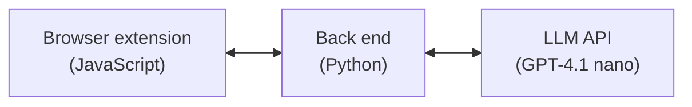

# Phishing-Extension

**English** | [中文](README.zh-TW.md)

A Chrome extension that warns you when the page you open is likely a phishing site. It sends the page's URL to a small Python back end, which asks a large language model (GPT-4.1 nano) whether the URL is phishing. No model is trained.

This is the browser extension proposed in my undergraduate capstone at National Taiwan Normal University (NTNU), advised by Prof. Albert Guan:

> Yao Yu Lee and Albert Guan. [Phishing Attack Simulation and Detection Strategies: A Case Study on NTNU Moodle Platform](https://easychair.org/publications/paper/WK6X). *Proceedings of the 20th Asia Joint Conference on Information Security (AsiaJCIS 2025)*, EPiC Series in Computing, vol. 106, pp. 114–121, 2025. DOI: 10.29007/58hg.

## How it works



| Part | What it does |
|---|---|
| Browser extension (JavaScript) | Sends the URL of the page you open to the back end. If the answer is "phishing", it shows a warning; otherwise nothing happens. |
| Back end (Python, Flask) | Keeps the prompt and the API key, sends the URL to the LLM, and returns the verdict to the extension. |
| LLM (GPT-4.1 nano) | Answers Y (likely phishing), N (legitimate) or U (unsure), judging only from the domain name and URL pattern. Both Y and U count as phishing. |

The approach follows ChatPhishDetector (T. Koide, H. Nakano and D. Chiba, *IEEE Access*, vol. 12, 2024, DOI: 10.1109/ACCESS.2024.3483905), which showed that LLMs can detect phishing sites without training a model, so the detector can keep up when attack techniques change. ChatPhishDetector analyzes the whole web page; this extension uses only the URL.

## Results

We tested the LLM's zero-shot judgment, using only the URL, on 40,000 URLs randomly sampled from the public Kaggle dataset *Phishing Site URLs* (28,678 benign and 11,322 phishing).

| Class | Precision | Recall | F1 |
|---|---:|---:|---:|
| Benign | 0.91 | 0.90 | 0.91 |
| Phishing | 0.76 | 0.79 | 0.77 |

Overall: accuracy 0.87, macro-average F1 0.84, weighted-average F1 0.87.

The script is [`backend/test.py`](backend/test.py), with the same prompt and settings as the back end (temperature 0). It counts Y and U as phishing, and also counts a request that fails as phishing. The sample is drawn without a fixed random seed, so a rerun uses a different 40,000 URLs.

## Demo

With the extension installed, opening a phishing page shows this warning ("Warning: this site may be a phishing site!"). The page below is the simulated NTNU Moodle login page from the authorized red-team exercise in the same study.


## Run it

### Back end

```bash
cd backend
python3 -m venv venv
source venv/bin/activate          # Linux/macOS
pip install -r requirements.txt
echo "OPENAI_API_KEY=<your key>" > .env
python main.py                    # serves http://localhost:5000/check
```

Each URL the back end checks is appended to `backend/urls.txt` together with the model's answer. The file stays on your computer (it is in `.gitignore`).

### Extension

1. Open Chrome and go to `chrome://extensions/`.
2. Turn on **Developer mode** (top right).
3. Click **Load unpacked** and choose the `extension/` folder.

### Reproduce the evaluation

1. Download the Kaggle dataset *Phishing Site URLs* and save it as `backend/test.csv` (columns `URL` and `Label`, with labels `good` and `bad`).
2. `pip install pandas scikit-learn`
3. `cd backend && python test.py`. It sends 40,000 requests to the OpenAI API, which costs money, and prints precision, recall and F1 for each class.
