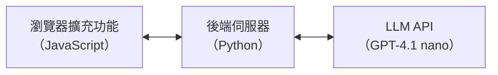
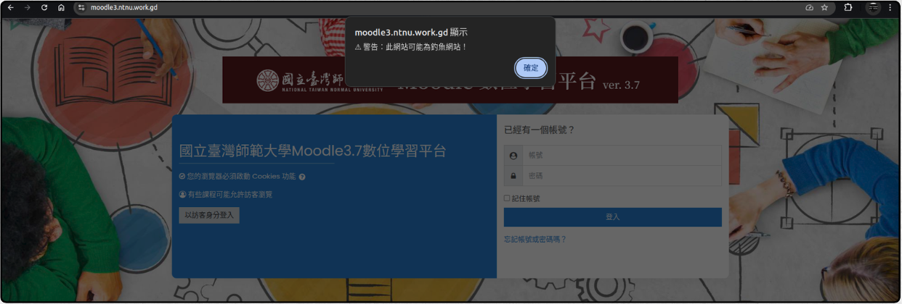

# Phishing-Extension

[English](README.md) | **中文**

一個 Chrome 擴充功能：打開的網頁如果可能是釣魚網站，就跳出警告。它把網頁的網址送到一個小型的 Python 後端，由後端詢問大型語言模型（GPT-4.1 nano）這個網址是不是釣魚網站。不需要自己訓練模型。

這是我在國立臺灣師範大學（NTNU）資工系畢業專題中提出的瀏覽器擴充功能，指導老師是官振傑（Albert Guan）教授：

> Yao Yu Lee and Albert Guan. [Phishing Attack Simulation and Detection Strategies: A Case Study on NTNU Moodle Platform](https://easychair.org/publications/paper/WK6X). *Proceedings of the 20th Asia Joint Conference on Information Security (AsiaJCIS 2025)*, EPiC Series in Computing, vol. 106, pp. 114–121, 2025. DOI: 10.29007/58hg.

## 運作方式



| 部分 | 做什麼 |
|---|---|
| 瀏覽器擴充功能（JavaScript） | 把你打開的網頁網址送給後端；如果判定是釣魚網站就跳出警告視窗，不是就什麼都不做。 |
| 後端伺服器（Python，Flask） | 保存提示詞（prompt）與 API 金鑰，把網址傳給 LLM，再把判定結果回傳給擴充功能。 |
| LLM（GPT-4.1 nano） | 只根據網域名稱和網址樣式判斷，回答 Y（可能是釣魚）、N（正常）或 U（不確定）。Y 和 U 都算釣魚。 |

這個做法參考 ChatPhishDetector（T. Koide、H. Nakano、D. Chiba，*IEEE Access* 第 12 卷，2024，DOI: 10.1109/ACCESS.2024.3483905）。該研究證明 LLM 不需要自行訓練模型就能偵測釣魚網站，因此能快速應對攻擊手法的變化。ChatPhishDetector 分析整個網頁；這個擴充功能只看網址。

## 辨識結果

我們從 Kaggle 公開資料集 *Phishing Site URLs* 隨機選取 40,000 個網址（28,678 個正常網站、11,322 個釣魚網站），只給 LLM 網址、不提供範例（zero-shot），測試結果如下：

| 類別 | Precision | Recall | F1 |
|---|---:|---:|---:|
| 正常網站 | 0.91 | 0.90 | 0.91 |
| 釣魚網站 | 0.76 | 0.79 | 0.77 |

整體：Accuracy 0.87，Macro avg F1 0.84，Weighted avg F1 0.87。

評估程式是 [`backend/test.py`](backend/test.py)，提示詞和設定與後端相同（temperature 0）。Y 和 U 都算釣魚，呼叫失敗的網址也算釣魚。抽樣沒有固定亂數種子，所以重跑會抽到不同的 40,000 個網址。

## 示範

安裝擴充功能後，打開釣魚網站時會跳出以下警告。畫面中的網頁是同一個研究裡、經授權的紅隊演練所架設的仿冒師大 Moodle 登入頁。



## 執行方式

### 後端

```bash
cd backend
python3 -m venv venv
source venv/bin/activate          # Linux/macOS
pip install -r requirements.txt
echo "OPENAI_API_KEY=<你的金鑰>" > .env
python main.py                    # 在 http://localhost:5000/check 提供服務
```

後端檢查過的每個網址和模型的回答會寫進 `backend/urls.txt`，這個檔案只留在你的電腦上（已列在 `.gitignore`）。

### 擴充功能

1. 打開 Chrome，前往 `chrome://extensions/`。
2. 開啟右上角的「開發人員模式」。
3. 點選「載入未封裝擴充功能」，選擇 `extension/` 資料夾。

### 重跑評估

1. 從 Kaggle 下載資料集 *Phishing Site URLs*，存成 `backend/test.csv`（欄位 `URL`、`Label`，標籤是 `good`、`bad`）。
2. `pip install pandas scikit-learn`
3. `cd backend && python test.py`。會呼叫 OpenAI API 40,000 次（要付費），最後印出每一類的 precision、recall、F1。
